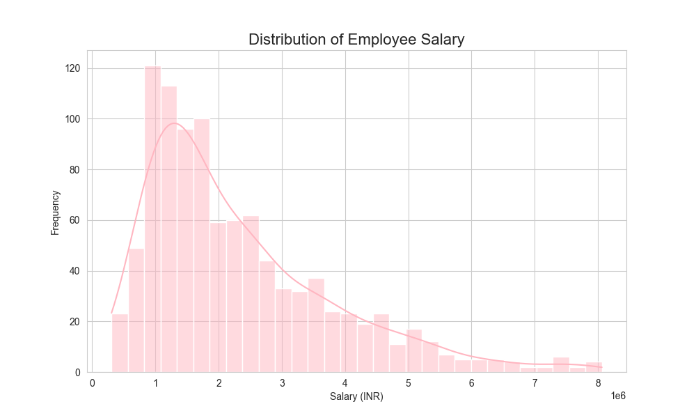
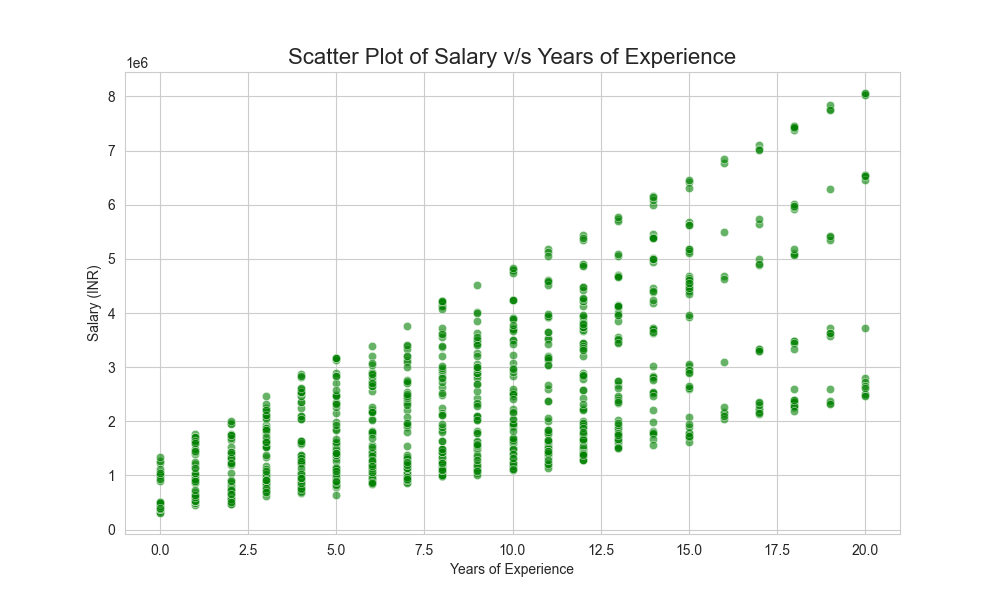
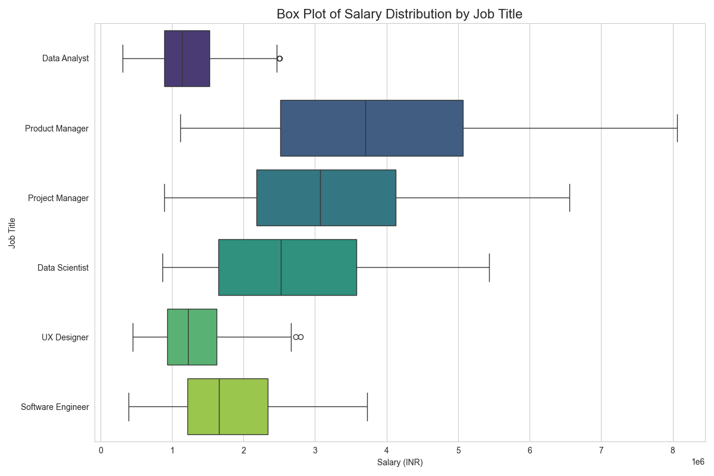
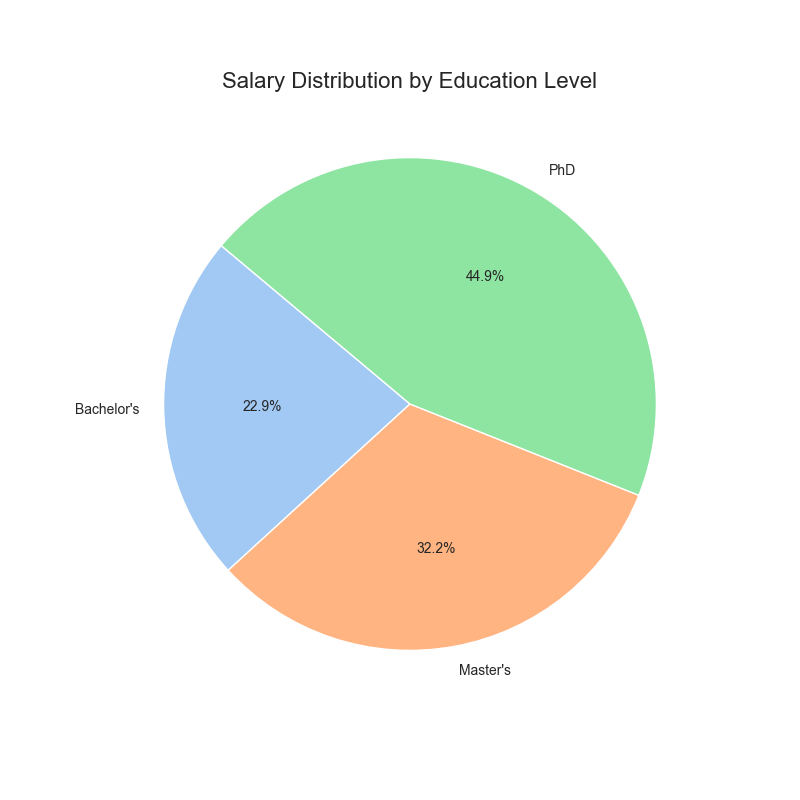

# Salary Prediction Model

A machine learning project that predicts an employee's salary (in INR) from job title, years of experience, education level and age. The trained model is served through a **Flask REST API** with a simple web interface.

##  Problem Statement
Estimating a fair salary is difficult for both job seekers and employers. This project builds a regression model that predicts salary from a few key profile features.

##  Dataset
- **Source:** Synthetic dataset generated in `project.py`, based on salary patterns for the Indian market (INR)
- **Size:** 1,000 rows × 5 columns (`employees_large.csv`)
- **Features:** Job Title, Years of Experience, Education Level, Age
- **Target:** Salary (INR)

##  Tech Stack
Python, Flask, Pandas, NumPy, Scikit-learn, Matplotlib, Seaborn, HTML, Tailwind CSS

##  Approach
1. Generated the dataset with realistic salary rules (job title, experience, education)
2. Explored and visualized feature relationships (Matplotlib, Seaborn)
3. Built a preprocessing pipeline (StandardScaler for numeric, OneHotEncoder for categorical features)
4. Tuned Random Forest and Gradient Boosting models using GridSearchCV (5-fold CV)
5. Combined them with Linear Regression into a **Voting Regressor** ensemble
6. Evaluated on a held-out 20% test set using R² and MAE
7. Served predictions through a Flask REST API (`POST /predict`) with input validation (experience must be realistic for the given age)

##  Results
- **Final model:** Voting Regressor (Gradient Boosting + Random Forest + Linear Regression)
- **R² Score:** ~0.99
- **MAE:** ~₹1 lakh

*Run `python project.py` to reproduce the exact scores.*

##  Visualizations

| Salary Distribution | Salary vs Experience |
|---|---|
|  |  |

| Salary by Job Title | Salary by Education |
|---|---|
|  |  |

##  Project Structure
```
├── project.py                # Data generation, EDA, model training
├── app.py                    # Flask API
├── templates/index.html      # Web interface
├── employees_large.csv       # Dataset
├── requirements.txt
└── *.png                     # Visualizations
```

##  How to Run
1. Clone the repo
   ```
   git clone https://github.com/akshitomar2019-wq/Salarypredictionmodel.git
   cd Salarypredictionmodel
   ```
2. Install requirements
   ```
   pip install -r requirements.txt
   ```
3. Train the model (creates `salary_prediction_model_enhanced.pkl`)
   ```
   python project.py
   ```
4. Start the app
   ```
   python app.py
   ```
5. Open `http://127.0.0.1:5001` in your browser

##  API Example
`POST /predict`
```json
{
  "jobTitle": "Data Scientist",
  "experience": 5,
  "education": "Master's",
  "age": 29
}
```
Response:
```json
{ "predicted_salary": 2100000 }
```

##  Future Improvements
- Train on a real-world salary dataset
- Deploy the app online (Render / Google Cloud)
- Add more features such as location and skills
